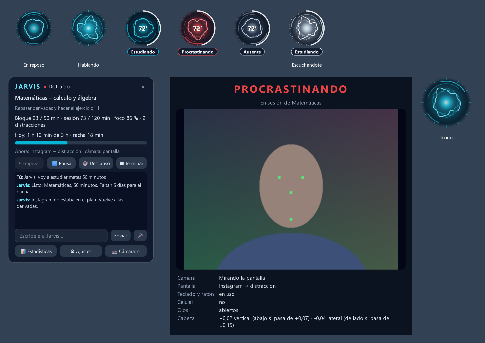

<div align="center">


# Jarvis — asistente de estudio con foco

**Un orbe en tu escritorio que ve tu pantalla y tu cara, te habla cuando te dispersas y mide cuánto te concentras.**
Voz y visión 100 % locales · cerebro con modelos de IA gratuitos · Windows · en español

</div>



## Qué hace

- **Sabe si estás estudiando.** Mira la ventana activa (y qué vídeo o PDF tiene abierto), si usas teclado y ratón, y con la cámara si estás frente al PC, mirando la pantalla, escribiendo en la tableta o con el celular en la mano.
- **Sabe si lo que ves es del tema.** Reglas rápidas (Instagram = distracción, Matlab = estudio, palabras de tu materia…) y, si no alcanzan, le pregunta a una IA solo el título de la ventana. Cada título se consulta una vez y tú puedes corregirlo: «Jarvis, esto sí es del tema».
- **Te habla.** Si te dispersas, primero suave y luego más firme (tono configurable: suave, firme o sargento). Te felicita cuando vuelves, te manda a descansar entre bloques y te recuerda tus exámenes.
- **Le hablas sin tocar nada.** Siempre escucha la palabra «Jarvis» (al inicio o al final de la frase): «Jarvis, sesión de 30 minutos», «¿qué hora es, Jarvis?», «Jarvis, pon música», «Jarvis, ¿qué estoy viendo?».
- **Sesiones a tu medida.** «2 horas en bloques de 40 con descansos de 10», «4 pomodoros», «dame 10 minutos más», «¿cuánto me falta?». Si pides un tiempo total, la sesión se cierra sola con un balance.
- **Estadísticas.** Informe diario en HTML: línea de tiempo, últimos 14 días frente a tu meta, en qué se fue el tiempo perdido y minutos por tema.

### Estados del orbe

| Etiqueta | Cuándo |
|---|---|
| **Estudiando** | material del tema en pantalla y tú mirando o usando el PC |
| **Estudiando (mesa)** | cabeza abajo sin tocar el PC: escribiendo en la tableta o en papel |
| **Pensando → Desconcentrado** | mirando a otro lado; tras 2 min pasa a «Desconcentrado» |
| **En el chat** | WhatsApp, Discord…: 90 s de gracia |
| **Procrastinando / Con el celular** | algo ajeno al tema más de 12 s, o el celular en la mano |
| **Con sueño · Ausente · Descanso** | ojos cerrados, no estás, o tiempo libre |

Sin sesión, el orbe es la onda cian de Jarvis, que se mueve con su voz y con la tuya.

## Privacidad

| Dato | Dónde se procesa |
|---|---|
| Imagen de la cámara | **solo en tu PC** (MediaPipe). Se analiza en memoria y se descarta; nunca se guarda ni se envía |
| Tu voz | **solo en tu PC**: detector de voz Silero, «hey Jarvis» con openWakeWord y transcripción con Whisper |
| Lo que le dices o escribes | sale como texto al proveedor de IA que elijas |
| Título de la ventana activa | sale solo cuando las reglas no bastan |
| Capturas de pantalla | **nunca**, salvo que actives `captura_para_dudas` |
| Estadísticas | `datos/jarvis.db`, en tu PC |

> Ojo: en los planes gratuitos de IA el proveedor puede usar lo que le envías para entrenar. No le dictes nada confidencial.

## Requisitos

- Windows 10/11, cámara web y micrófono.
- Python 3.11 ([uv](https://docs.astral.sh/uv/) recomendado).
- Una API compatible con OpenAI. Está pensado para [FreeLLMAPI](https://github.com/tashfeenahmed/freellmapi), que reparte las peticiones entre modelos gratuitos (Google, Groq, OpenRouter…), pero sirve cualquier endpoint `/v1/chat/completions`.
- Opcional: GPU NVIDIA para que Whisper vaya más rápido (con el modo `auto`, la usa enchufado y pasa al procesador con batería).

## Instalación

```powershell
git clone https://github.com/<tu-usuario>/jarvis-estudio.git
cd jarvis-estudio
uv venv --python 3.11 .venv
uv pip install --python .venv\Scripts\python.exe -r requirements.txt
```

La primera vez que se abre, Jarvis copia `config.ejemplo.toml` a `config.toml` y descarga los modelos de visión (~8 MB) y de la palabra clave.

**Clave de la IA**, una de tres formas:
1. `freellmapi_dir` en `config.toml` apuntando a tu FreeLLMAPI: Jarvis lo arranca solo si está apagado y lee su clave.
2. Variable de entorno `FREELLMAPI_KEY`.
3. Archivo `datos/jarvis.env` con la línea `FREELLMAPI_KEY=...` (está en `.gitignore`).

Cambia `url` en `[llm]` si usas otro proveedor compatible con OpenAI.

## Uso

```powershell
.\Jarvis.cmd                                   # abrir (sin consola)
.venv\Scripts\pythonw.exe -m jarvis --inicio    # abrir sin saludo hablado (para el arranque con Windows)
.venv\Scripts\pythonw.exe -m jarvis --reiniciar # reiniciar sin perder la sesión en curso
.venv\Scripts\pythonw.exe -m jarvis --salir     # cerrar limpio
```

Para que arranque con Windows, crea un acceso directo a `pythonw.exe -m jarvis --inicio` en `shell:startup`.

- **Clic** en el orbe: panel. **Doble clic** o `Ctrl+Alt+J`: hablarle. **Clic derecho**: menú (empezar sesión, silencio 2 horas, estadísticas, ajustes, ver lo que ve la cámara…).
- **Ver lo que ve la cámara** abre una ventana con la imagen en vivo anotada y lo que Jarvis concluye (ESTUDIANDO, PROCRASTINANDO…), para comprobar que te lee bien.

### Lo que le puedes decir

| Frase | Qué hace |
|---|---|
| sesión de 30 minutos · 2 horas en bloques de 40 con descansos de 10 · 4 pomodoros | empieza una sesión a tu medida |
| dame 10 minutos más · acórtala 15 · termina en 10 minutos · ¿cuánto me falta? | cambia el tiempo en marcha |
| descansos de 5 · bloques de 25 · cambia el tema a física · mi objetivo es… | ajusta la sesión |
| pausa · sigamos · descanso de 15 minutos · terminemos la sesión | controla la sesión |
| esto sí es del tema · esto no es del tema | corrige la clasificación |
| ¿qué estoy viendo? · ¿qué ventanas tengo abiertas? | lo describe al instante, sin IA |
| pon música · pausa la música · siguiente canción · sube el volumen | maneja Spotify |
| ¿cómo voy? · cállate · cualquier pregunta | estado, silencio 30 min, o responde la IA |

## Configuración

Todo está en `config.toml`, comentado: nombre y tono, voz (voces de Microsoft vía edge-tts), modelos de Whisper, cámara, segundos de gracia, duración de bloques y meta diaria, horas de recordatorio, **tus materias** (alias, palabras clave y carpetas de material) y **fechas de exámenes**.

## Cómo funciona

```
Pantalla ─┐                         ┌─ Coach (regaña, motiva, descansos) ─ Voz y orbe
Cámara ───┼─ Clasificador ─ Motor de foco                                    (edge-tts, Whisper,
Teclado ──┘   (¿es del tema?)  (estado cada segundo, con gracia)              «Jarvis»)
                    │                    └─ Estadísticas (SQLite + informes HTML)
                    └──── FreeLLMAPI / IA (solo texto) ────┘
```

| Módulo | Qué hace |
|---|---|
| `jarvis/app.py` | núcleo: bucle de 1 s, sesiones, órdenes, conversación |
| `jarvis/ui.py` | orbe animado, panel, globo, ventana de la cámara (PySide6) |
| `jarvis/camera.py` | rostro, mirada, ojos, celular y persona (MediaPipe) |
| `jarvis/screen.py` | ventana activa, archivos abiertos, inactividad (API de Windows) |
| `jarvis/classifier.py` | ¿lo que hay en pantalla es del tema? |
| `jarvis/focus.py` | estados de foco con periodos de gracia |
| `jarvis/coach.py` | qué decir y cuándo |
| `jarvis/voice.py` | hablar (edge-tts), escuchar siempre (Silero + Whisper), «hey Jarvis» |
| `jarvis/intents.py` | órdenes que no necesitan IA |
| `jarvis/llm.py` · `report.py` · `db.py` · `musica.py` | IA, informes, base de datos, Spotify |

## Pruebas

```powershell
.venv\Scripts\python.exe -m unittest discover -s tests -v   # 30 pruebas, sin red ni cámara
.venv\Scripts\python.exe tests\prueba_escucha.py            # detección de «Jarvis» con audio sintético
.venv\Scripts\python.exe tests\prueba_interfaz.py           # dibuja la interfaz en docs\interfaz.png
```

## Licencia

[MIT](LICENSE)
